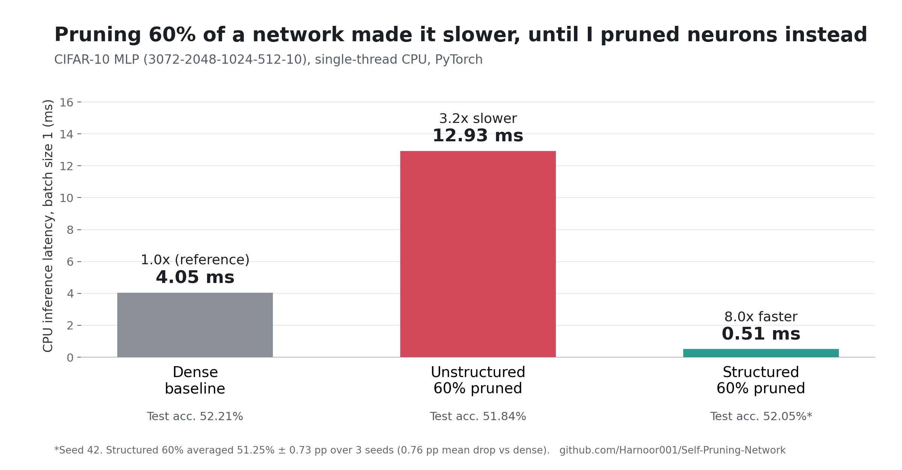
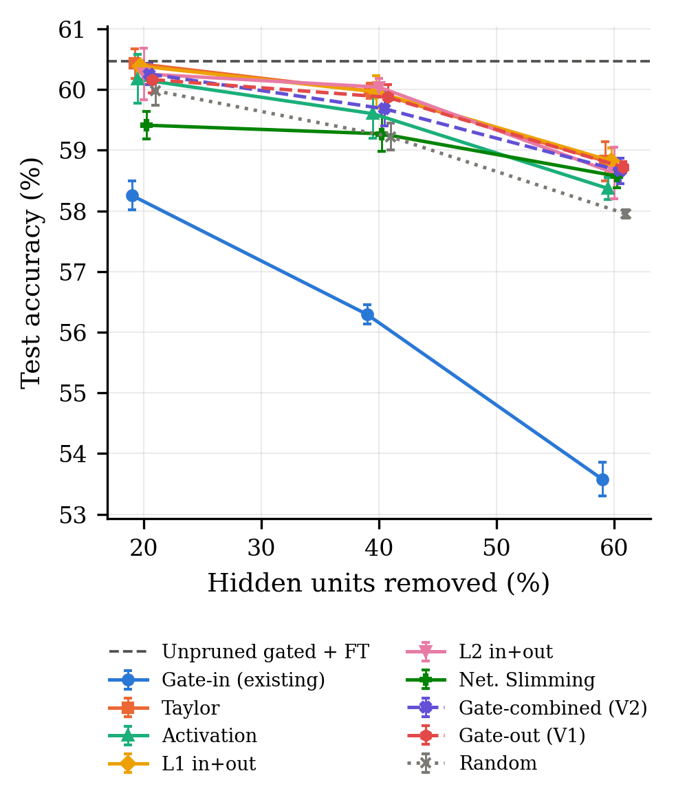
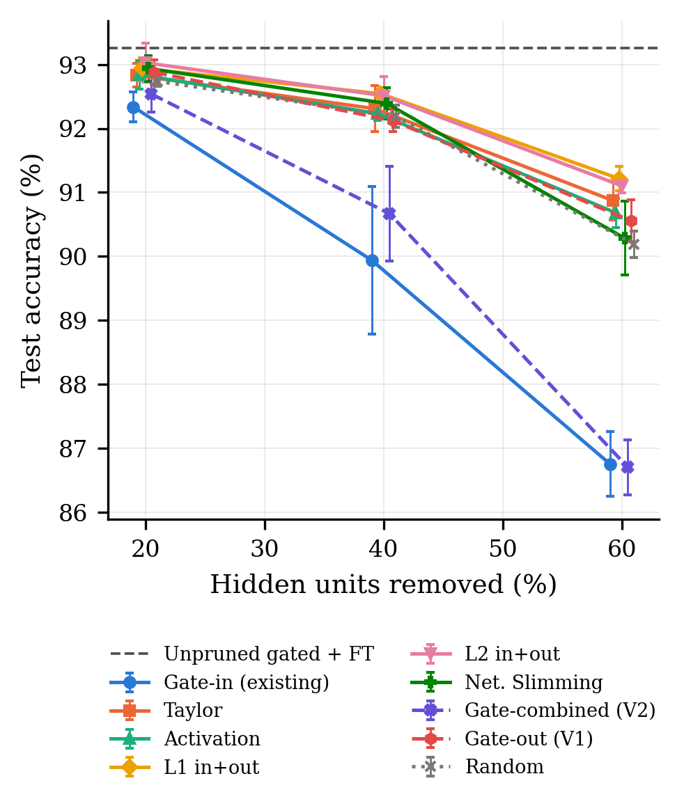

# Self-Pruning Neural Network

A PyTorch CIFAR-10 MLP that learns per-connection gate importance, converts those scores into explicit binary masks, hard-prunes connections, and fine-tunes with a fixed mask. A structured variant removes whole neurons and builds a physically smaller model.

> **Status (November 2026).** The original project (sections from [Key results](#key-results) onward) is unchanged. A comparative research study built on top of it is complete; its findings are summarised [below](#research-study-do-the-learned-gates-identify-prunable-neurons). A manuscript based on the study is being prepared for conference submission and is not included in this repository.

## Key results

Full CIFAR-10, seed 42, CPU (1 thread), batch size 1. All accuracy deltas are relative to the **dense baseline (52.21%)**.

| Model | Test accuracy | Δ vs dense | Deployable parameters | Mean latency | Speed vs dense |
|---|---:|---:|---:|---:|---:|
| Dense | 52.21% | n/a | 8.93M | 4.05 ms | 1.0x |
| Unstructured 60% (masked) | 51.84% | -0.37 pp | 8.93M (no change) | 12.93 ms | 3.2x **slower** |
| Structured 40% (neurons removed) | 52.72% | +0.51 pp | 4.73M (-47%) | 0.65 ms | 6.3x faster |
| Structured 60% (neurons removed) | 52.05% | -0.16 pp | 2.95M (-67%) | 0.51 ms | 8.0x faster |

Structured rows are single fine-tuning runs. Repeating the same seed-42 fine-tuning gave 51.29% to 52.05% for structured 60% (see [Measurement notes](#measurement-notes)), so treat the 3-seed means below as the more reliable figures.



**Across 3 seeds (42, 123, 2024):**

- Structured 60%: 51.25% ± 0.73 pp test accuracy, a mean drop of 0.76 ± 0.71 pp vs each seed's dense reference.
- Structured 40%: 52.82% ± 0.02 pp, at or above dense on average, and more stable across seeds.
- Learned pruning beat random pruning at 60% sparsity by 0.87 ± 0.17 pp on average (51.67% vs 50.80%).

**What these results mean:**

- **Sparsity is not speed.** Masking 60% of weights in dense `Linear` layers gave no speedup and no size reduction; it was slower in this environment. Only structured pruning, which builds smaller tensors, reduced latency and size.
- **Size comparison.** Deployable weights drop from about 35.7 MB to 11.8 MB (~3x smaller, estimated at 4 bytes per parameter). The 107 MB dense checkpoint file is larger because it also stores training-time gate tensors, so it is not a like-for-like comparison.
- These are single-environment measurements, not hardware-independent claims, and this is an MLP, not a state-of-the-art CIFAR-10 model. The goal is to measure compression trade-offs honestly.

## Research study: do the learned gates identify prunable neurons?

The study asks whether this project's learnable connection gates pick out unimportant neurons (or channels) better than conventional pruning criteria. Every criterion is compared under the same conditions: identical compact architectures per pruning ratio, the same fine-tuning budget, model selection on a validation split only, five seeds (42, 123, 2024, 7, 21), and a fixed 45k / 5k / 10k CIFAR-10 split. The original pipeline described in the rest of this README was not modified.

**Short answer: no.** The existing score (the mean incoming gate of a neuron, "gate-in") selected neurons *worse than random selection* on both architectures tested.

### Test accuracy after pruning and fine-tuning (%, mean ± SD over 5 seeds)

| | MLP, 20% removed | 40% | 60% | VGG-16-BN, 20% removed | 40% | 60% |
|---|---:|---:|---:|---:|---:|---:|
| **Gate-in (existing method)** | **58.26 ± 0.24** | **56.29 ± 0.16** | **53.58 ± 0.28** | **92.34 ± 0.24** | **89.94 ± 1.15** | **86.75 ± 0.51** |
| Random | 59.98 ± 0.24 | 59.22 ± 0.22 | 57.95 ± 0.07 | 92.74 ± 0.08 | 92.19 ± 0.17 | 90.19 ± 0.21 |
| L1 magnitude | 60.39 ± 0.09 | 59.96 ± 0.26 | 58.82 ± 0.21 | 92.94 ± 0.17 | 92.54 ± 0.07 | 91.22 ± 0.19 |
| Taylor | 60.43 ± 0.24 | 59.98 ± 0.13 | 58.82 ± 0.33 | 92.83 ± 0.19 | 92.31 ± 0.36 | 90.87 ± 0.30 |
| Network Slimming (own source) | 59.41 ± 0.23 | 59.27 ± 0.29 | 58.57 ± 0.19 | 92.94 ± 0.21 | 92.39 ± 0.24 | 90.28 ± 0.58 |
| Gate-out (variant V1) | 60.16 ± 0.21 | 59.87 ± 0.21 | 58.72 ± 0.08 | 92.88 ± 0.19 | 92.12 ± 0.17 | 90.56 ± 0.32 |
| Gate-combined (variant V2) | 60.26 ± 0.17 | 59.68 ± 0.28 | 58.66 ± 0.21 | 92.54 ± 0.28 | 90.67 ± 0.74 | 86.70 ± 0.43 |
| Unpruned + same fine-tuning | 60.46 ± 0.20 | | | 93.26 ± 0.27 | | |

All rows except Network Slimming score the same gated source model. MLP: 30-epoch sources, 5 fine-tuning epochs, CPU. VGG-16-BN: 160-epoch sources, 20 fine-tuning epochs, two Tesla T4 GPUs on Kaggle. Sixteen methods were compared in total; the full tables are in [research/results_analysis.md](research/results_analysis.md).

| MLP | VGG-16-BN |
|---|---|
|  |  |

### Findings

1. **Gate-in is worse than random on both architectures.**
   - MLP: below random on every seed at every ratio, by 1.7 / 2.9 / 4.4 pp. All 45 comparisons against the 15 alternatives are supported (paired t-test, Holm-corrected).
   - VGG-16-BN: 14 of 15 alternatives beat it on all five seeds at every ratio. After Holm correction 23 of 45 comparisons are supported: 8 at 20% (random is not one of them, +0.40 pp, p = 0.061), 1 at 40%, and 14 at 60% (random +3.44 pp).
   - Before fine-tuning, removing 20% of VGG channels by gate-in leaves the network at chance (10.8%), while random selection keeps 51.5%.
2. **Why.** Behind batch normalization, scaling all incoming weights of a neuron does not change the network function, so the level of a neuron's incoming gates carries no importance signal. In the default setting (penalty weight λ = 0) the gates also barely move from their initial value σ(2) = 0.881.
3. **The gate variants are not a reliable fix.** Reading the gates on the outgoing side (V1) or combining both sides (V2) recovers the accuracy of magnitude criteria on the MLP. On VGG-16-BN, V1 only matches random and V2 fails together with gate-in.
4. **A gate penalty helps on the MLP but not on VGG.** On the MLP any positive λ removes the gate-in deficit. On VGG-16-BN it reduces the deficit but does not remove it: the penalty shifts all gates together without separating channels (3 seeds, descriptive).
5. **No gate score beat the conventional criteria** in the main study. On VGG-16-BN, L1, L2, BN-scale, activation and Taylor end within about 1 pp of each other and of random after 20 fine-tuning epochs.
6. **Measured speed is below the theoretical saving.** Removing 60% of VGG channels cuts MACs by 84% (6.1× in theory) and gives a measured 2.92× on a Tesla T4 at batch 256, 3.56× on one CPU thread at batch 1, and no usable gain on the GPU at batch 1.
7. **The audit found a bug** in the original compact reconstruction (gates were not folded into the weights); the research code corrects it without changing the legacy pipeline. See [research/INITIAL_AUDIT.md](research/INITIAL_AUDIT.md).

**How this relates to the results below.** The legacy "learned vs random" comparison in this README is at the level of individual connections. The study above concerns whole neurons and channels, which is what structured pruning removes.

**Limits.** Two architectures, one dataset, the gate initialisation of the existing implementation, and three seeds for the ablations. Network Slimming is trained with its own objective, so its source differs. ResNet experiments were not run.

### Where things are

| Path | Content |
|---|---|
| [research/results_analysis.md](research/results_analysis.md) | All executed results with the file each number comes from |
| [research/experimental_protocol.md](research/experimental_protocol.md) | Fixed protocol, method definitions, statistics |
| [research/literature_review.md](research/literature_review.md), [research/novelty_audit.md](research/novelty_audit.md) | Verified references and what is (not) novel |
| [research/INITIAL_AUDIT.md](research/INITIAL_AUDIT.md) | Audit of the original repository |
| [research/RUNNING.md](research/RUNNING.md) | Exact commands for every stage (CPU, single GPU, Kaggle T4 x2) |
| `artifacts/research/{mlp,mlp_legacy_sources,vgg16,vgg16_cpu}/` | Result CSVs, analysis, plots, benchmarks, environment records |
| `configs/`, `scripts/research/`, `src/self_pruning_network/` | Configurations and code of the study |

The manuscript (`research/paper/`) is kept private while it is under preparation for conference submission. The analysis script still writes paper tables and figures to that folder locally.

## Quick start

```bash
pip install -r requirements.txt
pytest -q                                    # 64 tests (20 legacy + 44 research)
python scripts/train_and_report.py --epochs 5 --batch-size 128 --hidden-dims 2048 1024 512 --lambdas 0 0.001 --prune --pruning-strategy target --target-sparsities 20 40 60 80 --fine-tune-epochs 1
```

Full commands for every experiment are in [Reproduce](#reproduce). To serve a checkpoint, see [API](#api).

## Repository layout

| Path | Contents |
|---|---|
| `src/self_pruning_network/` | Model, gated layers, pruning, and training code |
| `scripts/` | Training, ablation, benchmark, and structured-pruning runners |
| `app/` | FastAPI inference service |
| `tests/` | Unit tests |
| `artifacts/` | Benchmark outputs (CSV, JSON, plots) that back every number in this README |

## Problem

Pruning can reduce the logical connectivity of a neural network. This project distinguishes logical sparsity from physical storage reduction and inference acceleration: setting entries to zero in an ordinary dense tensor does not automatically reduce checkpoint size, memory allocation, latency, or hardware work.

## Method

Each prunable weight has a learnable score S:

W_soft = W * sigmoid(S)

Training uses:

L = L_CE + lambda * L_sparsity

The original implementation initialized every score at 2.0, so each gate started at sigmoid(2) approximately 0.881. It measured sparsity only as gates below 0.01. Sigmoid saturation, gate-gradient scale, and the unnormalized sum over millions of gates made that threshold hard to reach. The old implementation also never created a binary mask or zeroed weights.

The corrected pipeline treats gates as importance scores. A gate does not need to naturally fall below 0.01:

gate learning -> importance ranking -> binary mask -> hard pruning -> fixed-mask fine-tuning -> evaluation

## Hard pruning

Threshold pruning uses:

M_i = 1 if g_i >= tau, else 0
W_hard = W * M

Target-sparsity pruning ranks all gate values globally across all prunable layers and removes the requested fraction. The model exposes soft, dense, and hard modes. During fine-tuning, the mask is re-applied after every optimizer step, preserving M_i = 0 => W_i = 0.

## Experimental audit

The old 51.74% result and the previous 31.84% result were not comparable:

| Configuration | Original reported run | Previous realistic run |
|---|---:|---:|
| Hidden dimensions | 2048 / 1024 / 512 | 128 / 64 |
| Weight connections | 8,918,016 | 402,048 |
| Training samples | 45,000 | 1,844 |
| Validation samples | 5,000 | 204 |
| Test samples | 10,000 | 1,024 |
| Epochs | 5 | 2 |
| Batch size | 128 | 128 |
| Learning rate | 0.0008 | 0.0008 |
| Optimizer | AdamW | AdamW |
| Scheduler | CosineAnnealingLR | CosineAnnealingLR |
| λ values | 0.0001 / 0.001 / 0.01 | 0.0001 / 0.001 |
| Hard pruning | No | Yes |

The architecture and dataset/training-budget changes explain the 51.74% to 31.84% difference. The old 51.74% checkpoint was a full-data soft-gated model with zero measured hard sparsity; the 31.84% result was a smaller subset experiment.

## Final full-data benchmark

This benchmark used the original architecture, full CIFAR-10 data, seed 42, deterministic 90/10 train-validation split, five training epochs, batch size 128, AdamW, learning rate 0.0008, weight decay 0.0001, CosineAnnealingLR, label smoothing 0.05, target-sparsity pruning, and one fine-tuning epoch at learning rate 0.0002.

Accuracy drops for hard models are relative to the corresponding unpruned selected soft model at λ = 0.0. Soft-model drops are relative to the separately trained dense baseline.

| Model | λ | Target sparsity | Actual sparsity | Density | Validation accuracy | Test accuracy | Accuracy drop | Total | Active | Pruned |
|---|---:|---:|---:|---:|---:|---:|---:|---:|---:|---:|
| Dense | — | 0% | 0% | 100% | 51.66% | 52.21% | 0 pp | 8,918,016 | 8,918,016 | 0 |
| Soft | 0 | — | 0% | 100% | 51.74% | 52.28% | -0.07 pp | 8,918,016 | 8,918,016 | 0 |
| Soft | 0.001 | — | 0% | 100% | 51.50% | 52.27% | -0.06 pp | 8,918,016 | 8,918,016 | 0 |
| Hard | 0 | 0% | 0% | 100% | 51.74% | 52.10% | 0.18 pp | 8,918,016 | 8,918,016 | 0 |
| Hard | 0 | 20% | 20.0000% | 80.0000% | 52.52% | 52.08% | 0.20 pp | 8,918,016 | 7,134,413 | 1,783,603 |
| Hard | 0 | 40% | 40.0000% | 60.0000% | 51.76% | 51.87% | 0.41 pp | 8,918,016 | 5,350,810 | 3,567,206 |
| Hard | 0 | 60% | 60.0000% | 40.0000% | 51.50% | 51.84% | 0.44 pp | 8,918,016 | 3,567,206 | 5,350,810 |
| Hard | 0 | 80% | 80.0000% | 20.0000% | 48.54% | 49.11% | 3.17 pp | 8,918,016 | 1,783,603 | 7,134,413 |

The maximum measured sparsity with a test-accuracy drop below one percentage point was 60%: 51.84% test accuracy, 0.44 percentage-point drop (relative to the unpruned soft model; 0.37 pp relative to dense), and 5,350,810 pruned connections.

Immediately after pruning and before fine-tuning, the 20%, 40%, 60%, and 80% models measured 50.61%, 50.65%, 49.80%, and 40.15% test accuracy. After one fine-tuning epoch they measured 52.08%, 51.87%, 51.84%, and 49.11%, respectively.

The generated source-of-truth artifacts are in [artifacts/final_benchmark/reports](artifacts/final_benchmark/reports), especially [results.csv](artifacts/final_benchmark/reports/results.csv), [results.md](artifacts/final_benchmark/reports/results.md), and [summary.json](artifacts/final_benchmark/reports/summary.json).

## Reproduce

Install dependencies:

```
python -m venv .venv
.\.venv\Scripts\Activate.ps1
pip install -r requirements.txt
```

Run the final benchmark:

```
python scripts\train_and_report.py --epochs 5 --batch-size 128 --hidden-dims 2048 1024 512 --lambdas 0 0.001 --prune --pruning-strategy target --target-sparsities 20 40 60 80 --fine-tune-epochs 1
```

For a labeled smoke test, add --train-subset and --test-subset and write to a separate output directory. Smoke-test numbers must not be presented as full-CIFAR-10 benchmark results.

Run the reproduced key learned-vs-random ablation (the executed full-data command):

```
python scripts\run_ablation.py --output-dir artifacts\ablation_key_benchmark --reuse-seed42 --seed42-checkpoint-dir artifacts\final_benchmark\checkpoints --seeds 42 123 2024 --targets 60 --multi-seed-targets 60 --epochs 5 --fine-tune-epochs 1 --batch-size 128 --hidden-dims 2048 1024 512 --device cpu
```

This command runs the dense/soft controls and learned/random 60% comparison for all three seeds. The 20/40/60/80 random sweep was not included in the official run because the full CPU training budget is expensive.

Threshold pruning is also available:

```
python scripts\train_and_report.py --prune --pruning-strategy threshold --prune-threshold 0.1 --fine-tune-epochs 1
```

## Checkpoints and deployment accounting

Checkpoints include model configuration, experiment configuration, gates, binary masks, pruning metadata, training history, and metrics. Legacy soft checkpoints without masks remain loadable.

Gate parameters are training-time auxiliary parameters. Unstructured deployment retains dense tensor shapes, so active/pruned counts represent logical connectivity reduction, not physical tensor-size reduction. Structured checkpoints instead contain compact tensor dimensions and are benchmarked separately; their measured latency is environment-specific.

## API

Set MODEL_CHECKPOINT to a dense, soft, or hard-pruned checkpoint:

```
$env:MODEL_CHECKPOINT="artifacts\final_benchmark\checkpoints\hard_target_0.6000.pt"
python -m uvicorn app.api:app --reload
```

GET /model/summary reports layer metrics plus total, active, pruned, density, sparsity, and threshold fields.

## Efficiency & Compression Analysis

The efficiency benchmark reloaded the validated final checkpoints without retraining:

```
python scripts\benchmark.py --benchmark-dir artifacts\final_benchmark --output-dir artifacts\efficiency_benchmark --warmup 20 --iterations 50 --batch-sizes 1 32 --device cpu --threads 1
```

The run used CPU, PyTorch 2.11.0+cpu, Python 3.11.9, seed 42, 20 warm-up iterations, and 50 measured iterations. The complete source-of-truth files are in [artifacts/efficiency_benchmark/reports](artifacts/efficiency_benchmark/reports), including [efficiency_results.csv](artifacts/efficiency_benchmark/reports/efficiency_results.csv), [efficiency_results.md](artifacts/efficiency_benchmark/reports/efficiency_results.md), [layer_efficiency.csv](artifacts/efficiency_benchmark/reports/layer_efficiency.csv), and [summary.json](artifacts/efficiency_benchmark/reports/summary.json).

### Logical connectivity and theoretical computation

The model has 8,918,016 dense weight slots and 8,918,016 dense linear MACs under the estimator used here. At 60% logical sparsity, 5,350,810 connections are masked and 3,567,206 remain active. The ideal sparse-execution estimate is therefore 3,567,206 effective MACs, a 60.000004% theoretical MAC reduction. This is not a measured runtime reduction: ordinary dense PyTorch kernels still operate on dense tensor shapes.

The 60% hard-pruned per-layer accounting was:

| Layer | Input | Output | Total | Active | Pruned | Dense MACs | Estimated effective MACs |
|---|---:|---:|---:|---:|---:|---:|---:|
| layer1 | 3,072 | 2,048 | 6,291,456 | 2,476,666 | 3,814,790 | 6,291,456 | 2,476,666 |
| layer2 | 2,048 | 1,024 | 2,097,152 | 863,508 | 1,233,644 | 2,097,152 | 863,508 |
| layer3 | 1,024 | 512 | 524,288 | 225,847 | 298,441 | 524,288 | 225,847 |
| layer4 | 512 | 10 | 5,120 | 1,185 | 3,935 | 5,120 | 1,185 |

### Measured accuracy, storage, and latency

Accuracy is from the final full-CIFAR-10 benchmark. Checkpoint sizes are measured file sizes; MB is decimal and MiB is binary. Latency is mean CPU inference latency from the same benchmark run; the CSV and Markdown report also contain p50 and p95.

| Model | Sparsity | Test accuracy | Accuracy drop | Active | Pruned | Effective MACs | MAC reduction | Checkpoint bytes | MB | Batch-1 mean ms | Batch-32 mean ms |
|---|---:|---:|---:|---:|---:|---:|---:|---:|---:|---:|---:|
| Dense | 0% | 52.21% | 0.00 pp | 8,918,016 | 0 | 8,918,016 | 0.000000% | 107,104,166 | 107.104166 | 3.443226 | 21.431260 |
| Soft | 0% | 52.28% | -0.07 pp | 8,918,016 | 0 | 8,918,016 | 0.000000% | 107,104,125 | 107.104125 | 29.452186 | 54.027230 |
| Hard 20% | 20.0000% | 52.08% | 0.20 pp | 7,134,413 | 1,783,603 | 7,134,413 | 19.999998% | 107,103,805 | 107.103805 | 13.285496 | 30.394612 |
| Hard 40% | 40.0000% | 51.87% | 0.41 pp | 5,350,810 | 3,567,206 | 5,350,810 | 39.999996% | 107,103,805 | 107.103805 | 14.249796 | 35.967308 |
| Hard 60% | 60.0000% | 51.84% | 0.44 pp | 3,567,206 | 5,350,810 | 3,567,206 | 60.000004% | 107,103,805 | 107.103805 | 13.666054 | 30.459748 |
| Hard 80% | 80.0000% | 49.11% | 3.17 pp | 1,783,603 | 7,134,413 | 1,783,603 | 80.000002% | 107,103,805 | 107.103805 | 13.694068 | 30.654848 |

The hard-pruned checkpoints remain effectively the same size as the dense checkpoint because they retain the same dense tensor dimensions. The measured hard-60 file was 107,103,805 bytes versus 107,104,166 bytes for Dense; the 361-byte difference is checkpoint metadata, not physical sparse compression. No physical parameter or memory reduction is claimed.

On this CPU run, 60% logical sparsity did not produce a dense-kernel speedup: Hard 60% averaged 13.666054 ms at batch 1 and 30.459748 ms at batch 32, compared with 3.443226 ms and 21.431260 ms for Dense. The measured mean latency changes relative to Dense were -296.896805% and -42.127658% respectively, where a negative value means slower. The single-thread run also showed scheduling variability in p95 measurements, so these are environment-specific observations, not hardware-independent claims.

### Interpretation and required future optimization

Logical sparsity, theoretical MAC reduction, physical storage, and measured latency are separate properties. Actual storage reduction would require a physically sparse or compressed representation. Actual acceleration would require structured pruning, sparse tensor kernels, hardware-supported sparsity, or compiler/runtime support that skips zero-valued connections. Unstructured binary masks on dense `Linear` layers do not provide those benefits automatically.

## Ablation Study

The learned-vs-random ablation uses the same full-CIFAR-10 architecture, data split, seed-specific soft-gated checkpoint, global target sparsity, and one-epoch fixed-mask fine-tuning budget. The only selection difference is whether the lowest gate scores or a reproducible random permutation determines the pruned connections. The comparison uses `lambda = 0` for the soft-gated source checkpoint so that the ablation tests pruning selection rather than a different sparsity-training objective.

The full three-seed run was deliberately limited to the key 60% target because the full MLP is expensive on CPU. The implementation accepts arbitrary target levels; the existing final benchmark separately contains learned 20%, 40%, 60%, and 80% results, but this ablation run does not claim random results at those levels.

### Learned vs random pruning at 60%

| Seed | Dense test | Soft λ=0 test | Learned test | Random test | Learned advantage |
|---:|---:|---:|---:|---:|---:|
| 42 | 52.21% | 52.28% | 51.82% | 50.84% | +0.98 pp |
| 123 | 51.80% | 51.81% | 51.74% | 51.06% | +0.68 pp |
| 2024 | 52.01% | 51.69% | 51.46% | 50.50% | +0.96 pp |

All six pruned models have exactly 5,350,810 pruned and 3,567,206 active connections out of 8,918,016 (60.000004% measured logical sparsity). Across the three seeds, learned pruning reached 51.6733% ± 0.1890% test accuracy, versus 50.8000% ± 0.2821% for random pruning. The paired mean advantage was 0.8733 ± 0.1677 percentage points (sample standard deviation). This is descriptive evidence, not a statistical-significance claim.

### Ablation and fine-tuning recovery

The seed-42 positive-regularization soft ablation reached 52.27% test accuracy at `lambda = 0.001`, with no hard mask applied. For the multi-seed key comparison, the hard models were derived from the corresponding `lambda = 0` soft checkpoint.

| Seed | Learned before FT → after FT | Random before FT → after FT |
|---:|---:|---:|
| 42 | 49.80% → 51.82% (+2.02 pp) | 13.65% → 50.84% (+37.19 pp) |
| 123 | 46.90% → 51.74% (+4.84 pp) | 12.45% → 51.06% (+38.61 pp) |
| 2024 | 49.33% → 51.46% (+2.13 pp) | 11.80% → 50.50% (+38.70 pp) |

The corresponding accuracy drops from each seed's unpruned soft reference were 0.46, 0.07, and 0.23 pp for learned pruning, and 1.44, 0.75, and 1.19 pp for random pruning. Mean drops were 0.2533 ± 0.1960 pp and 1.1267 ± 0.3493 pp, respectively.

### Layer-wise and mask analysis

At seed 42 and 60% target sparsity, learned pruning removed 60.6345%, 58.8247%, 56.9231%, and 76.8555% of the connections in layers 1–4. Random pruning removed 60.0279%, 59.9349%, 59.9348%, and 59.1016%. This run therefore suggests that the learned ranking concentrated more pruning in the final layer; the observation is configuration-specific.

The overlap between learned-pruned and random-pruned connection sets was 59.9903% at seed 42, 59.9758% at seed 123, and 59.9881% at seed 2024. These overlap values are descriptive and should not be interpreted as an importance validation by themselves.

The source-of-truth ablation artifacts are in [artifacts/ablation_key_benchmark/reports](artifacts/ablation_key_benchmark/reports), including [ablation_results.csv](artifacts/ablation_key_benchmark/reports/ablation_results.csv), [multi_seed_results.csv](artifacts/ablation_key_benchmark/reports/multi_seed_results.csv), [learned_advantage.csv](artifacts/ablation_key_benchmark/reports/learned_advantage.csv), [layerwise_results.csv](artifacts/ablation_key_benchmark/reports/layerwise_results.csv), [mask_overlap.csv](artifacts/ablation_key_benchmark/reports/mask_overlap.csv), and [summary.json](artifacts/ablation_key_benchmark/reports/summary.json). The reproducible runner is [scripts/run_ablation.py](scripts/run_ablation.py).

## Structured Pruning

Unstructured pruning masks individual weights while retaining the original dense tensor dimensions. Structured pruning instead ranks hidden neurons using the mean sigmoid gate value across each neuron's outgoing weight row, removes the lowest-ranked neurons independently in each hidden layer, and constructs a new compact model. Keep indices propagate through adjacent layers, and surviving biases and BatchNorm parameters are transferred with the surviving neurons. The output layer remains 10 classes.

The final full-data benchmark used the validated soft checkpoint, CIFAR-10 45,000/5,000/10,000 train/validation/test splits, seed 42, five fine-tuning epochs, CPU inference timing, one thread, 10 warm-up iterations, and 30 measured iterations per batch size. The command was:

```
python scripts\run_structured_pruning.py --checkpoint artifacts\final_benchmark\checkpoints\soft_lambda_0.0000.pt --dense-checkpoint artifacts\final_benchmark\checkpoints\dense_lambda_0.0000.pt --unstructured-checkpoint artifacts\final_benchmark\checkpoints\hard_target_0.6000.pt --targets 20 40 60 --fine-tune-epochs 5 --batch-size 128 --batch-sizes 1 32 --warmup 10 --iterations 30 --threads 1 --device cpu --output-dir artifacts\structured_pruning
```

### Compact architectures and measured results

Parameter counts include linear weights and biases plus trainable BatchNorm parameters. Gate scores are excluded from deployment parameter counts because compact models do not need them. Dense and unstructured rows use the existing dense-shaped checkpoints; unstructured MAC reduction is an ideal masked estimate, while structured MAC reduction is calculated from the compact matrices.

"Drop vs soft" is measured against the unpruned soft model (52.28%), the convention used throughout this README's benchmark tables. "Drop vs dense" is measured against the separately trained dense baseline (52.21%). Negative values mean the pruned model scored higher.

| Model | Architecture | Test accuracy | Drop vs soft | Drop vs dense | Deployable parameters | Parameter reduction | Effective MACs | MAC reduction | Checkpoint MB | Batch-1 mean ms | Batch-32 mean ms |
|---|---|---:|---:|---:|---:|---:|---:|---:|---:|---:|---:|
| Dense | 3072 → 2048 → 1024 → 512 → 10 | 52.21% | n/a | 0.00 pp | 8,928,778 | 0.00% | 8,918,016 | 0.00% | 107.104166 | 4.053557 | 21.408327 |
| Unstructured 60% | 3072 → 2048 → 1024 → 512 → 10 | 51.84% | 0.44 pp | 0.37 pp | 8,928,778 | 0.00% | 3,567,206 | 60.000004%* | 107.103805 | 12.930140 | 35.034263 |
| Structured 20% | 3072 → 1639 → 820 → 410 → 10 | 52.89% | -0.61 pp | -0.68 pp | 6,727,905 | 24.649207% | 6,719,288 | 24.654901% | 26.985815 | 1.140637 | 6.557863 |
| Structured 40% | 3072 → 1229 → 615 → 308 → 10 | 52.72% | -0.44 pp | -0.51 pp | 4,730,289 | 47.021989% | 4,723,823 | 47.030562% | 18.987863 | 0.646763 | 4.220197 |
| Structured 60% | 3072 → 820 → 410 → 205 → 10 | 52.05% | 0.23 pp | 0.16 pp | 2,945,655 | 67.009427% | 2,941,340 | 67.018000% | 11.841623 | 0.506517 | 2.612670 |

The structured models have physically smaller tensors. Their measured checkpoint sizes were 26,985,815 bytes, 18,987,863 bytes, and 11,841,623 bytes for 20%, 40%, and 60% neuron pruning, compared with 107,104,166 bytes for the dense checkpoint. This comparison includes the dense checkpoint's training-time gate tensors; it is an actual file-size comparison, not an estimate from parameter count. A like-for-like estimate of the dense model's deployable weights (8,928,778 parameters at 4 bytes each) is about 35.7 MB, which makes the 60% compact model roughly 3x smaller.

### Fine-tuning recovery

| Model | Before fine-tuning | After fine-tuning | Recovery |
|---|---:|---:|---:|
| Structured 20% | 37.89% | 52.89% | +15.00 pp |
| Structured 40% | 28.02% | 52.72% | +24.70 pp |
| Structured 60% | 21.75% | 52.05% | +30.30 pp |

These values come from the final compact benchmark (`artifacts/structured_pruning/reports/fine_tuning_recovery.csv`). The separate recovery ablation below reports slightly different 5-epoch values; see [Measurement notes](#measurement-notes).

### Layer-wise neuron counts

| Model | Hidden 1 | Hidden 2 | Hidden 3 | Output |
|---|---:|---:|---:|---:|
| Original | 2048 → 2048 | 1024 → 1024 | 512 → 512 | 10 → 10 |
| Structured 20% | 2048 → 1639 | 1024 → 820 | 512 → 410 | 10 → 10 |
| Structured 40% | 2048 → 1229 | 1024 → 615 | 512 → 308 | 10 → 10 |
| Structured 60% | 2048 → 820 | 1024 → 410 | 512 → 205 | 10 → 10 |

After five fine-tuning epochs, all three compact models matched or came within 0.16 percentage points of the dense baseline (52.21%) in this single seed-42 run; structured 20% reached 52.89%, structured 40% reached 52.72%, and structured 60% reached 52.05%. The 60% compact model provides the largest physical reduction: 67.009427% fewer deployable parameters and 67.018000% fewer dense MACs.

Structured pruning reduced measured CPU latency in this run: batch-1 mean latency fell from 4.053557 ms for Dense to 1.140637 ms, 0.646763 ms, and 0.506517 ms for Structured 20%, 40%, and 60%. Batch-32 mean latency fell from 21.408327 ms to 6.557863 ms, 4.220197 ms, and 2.612670 ms. These are environment-specific measurements, not universal speedup guarantees. The unstructured 60% masked model was slower than Dense because it still uses the original dense tensor shapes.

The structured source-of-truth artifacts are in [artifacts/structured_pruning/reports](artifacts/structured_pruning/reports), including [structured_results.csv](artifacts/structured_pruning/reports/structured_results.csv), [structured_results.md](artifacts/structured_pruning/reports/structured_results.md), [fine_tuning_recovery.csv](artifacts/structured_pruning/reports/fine_tuning_recovery.csv), [layerwise_neuron_pruning.csv](artifacts/structured_pruning/reports/layerwise_neuron_pruning.csv), and [summary.json](artifacts/structured_pruning/reports/summary.json). Plots are in [artifacts/structured_pruning/plots](artifacts/structured_pruning/plots). The compact checkpoint builder and benchmark are in [scripts/run_structured_pruning.py](scripts/run_structured_pruning.py).

The asterisk on the unstructured MAC row means the value is an ideal effective-MAC estimate under sparse execution. Structured MAC values come from actual smaller dense matrix dimensions.

### Structured pruning accuracy recovery

The full-data recovery ablation isolated fine-tuning duration while keeping the transferred compact model, pruning indices, optimizer, data, and evaluation protocol fixed. Results are test accuracy; recovery is relative to the immediately constructed compact model.

| Target | 0 epochs | 1 epoch | 3 epochs | 5 epochs |
|---:|---:|---:|---:|---:|
| Structured 20% | 37.89% | 50.54% | 52.75% | 53.04% |
| Structured 40% | 28.02% | 48.42% | 51.48% | 52.56% |
| Structured 60% | 21.75% | 47.29% | 50.37% | 51.29% |

This is a separate execution from the final compact benchmark, so its 5-epoch column differs slightly from the tables above. Five epochs was selected for the final compact benchmark because every target still improved from three to five epochs (+0.29, +1.08, and +0.92 percentage points for 20%, 40%, and 60%). This is a practical fixed budget, not evidence that training has fully converged. The source-of-truth recovery files are in [artifacts/structured_recovery/reports](artifacts/structured_recovery/reports), including [recovery_results.csv](artifacts/structured_recovery/reports/recovery_results.csv) and [summary.json](artifacts/structured_recovery/reports/summary.json).

### Multi-seed validation

The selected five-epoch compact models were validated from the existing full-data soft checkpoints for seeds 42, 123, and 2024. Mean and standard deviation use the sample standard deviation.

| Model | Mean test accuracy | Std | Mean dense-relative drop | Std |
|---|---:|---:|---:|---:|
| Structured 40% | 52.8233% | 0.0208 pp | -0.8167 pp | 0.2250 pp |
| Structured 60% | 51.2467% | 0.7310 pp | 0.7600 pp | 0.7104 pp |

The seed-42 entries in this validation (52.80% at 40%, 51.84% at 60%) come from the multi-seed run itself. The per-seed values are in `multi_seed_results.csv`: at 60% they are 51.84%, 51.47%, and 50.43% for seeds 42, 123, and 2024. The 40% result was more stable and had higher mean accuracy in these three seeds. The 60% result retained substantially more physical reduction, with a larger but still sub-one-point mean dense-relative drop. Three seeds provide robustness evidence, not statistical significance. The source-of-truth files are in [artifacts/structured_multiseed/reports](artifacts/structured_multiseed/reports), including [multi_seed_results.csv](artifacts/structured_multiseed/reports/multi_seed_results.csv) and [multi_seed_summary.md](artifacts/structured_multiseed/reports/multi_seed_summary.md).

## Measurement notes

- **Separate benchmark runs.** The efficiency benchmark and the structured-pruning benchmark are separate executions, so their dense latencies differ (3.44 ms vs 4.05 ms at batch 1). Compare latencies only within a single table.
- **Repeated configurations.** The same seed-42 structured models were fine-tuned in three separate executions. All three start from the identical pruned model (pre-fine-tuning test accuracy of 37.89%, 28.02%, and 21.75% for the 20%, 40%, and 60% targets), and the recovery and multi-seed summaries record the same learning rate, weight decay, and label smoothing, yet the final accuracies differ:

  | Run | Source | Structured 20% | Structured 40% | Structured 60% |
  |---|---|---:|---:|---:|
  | Final compact benchmark | `structured_pruning/reports/structured_results.csv` | 52.89% | 52.72% | 52.05% |
  | Recovery ablation (5 epochs) | `structured_recovery/reports/recovery_results.csv` | 53.04% | 52.56% | 51.29% |
  | Multi-seed validation (seed 42) | `structured_multiseed/reports/multi_seed_results.csv` | n/a | 52.80% | 51.84% |

  The spread is up to 0.76 pp at 60%, which is comparable to the seed-to-seed standard deviation (0.73 pp). This is most likely run-to-run variation in fine-tuning (for example data order), not a controlled repeat. Differences below about 1 pp between single structured 60% runs should be treated as noise; use the three-seed means for comparisons.
- **Accuracy-drop baselines.** Drops in the benchmark tables are relative to the unpruned soft model unless a column says "vs dense".

## Testing

Run:

```
pytest -q
```

The current test run passes 64 tests (20 for the original pipeline, 44 for the research code). Tests cover dense forward behavior, soft gate gradients, gate conversion, threshold masks, exact zeroing, fixed-mask enforcement, target sparsity, reproducible random and learned masks, structured dimension compaction, weight and BatchNorm transfer, parameter/MAC accounting, checkpoint reload, accuracy-drop calculation, and compact-model fine-tuning invariants.

## Limitations

- This is an MLP rather than a CNN, so it has limited image inductive bias.
- The full 20/40/60/80 learned-vs-random sweep was not run across all seeds because the full CPU benchmark is expensive. The key 60% learned/random comparison was run at seeds 42, 123, and 2024; the full final learned benchmark remains the seed-42 run above.
- The unstructured path retains dense tensor shapes; structured pruning is a separate compact-model transformation.
- Structured CPU latency improvements were measured in one environment and should not be generalized to other hardware or runtimes.
- Logical sparsity in the unstructured path does not imply storage compression or hardware acceleration.
- Structured pruning physically reduces tensor dimensions, parameters, checkpoint size, and measured CPU latency in the executed benchmark, but results are tied to this architecture and environment.
- The final benchmark uses five training epochs plus five compact-model fine-tuning epochs and is a reproducible engineering benchmark, not a state-of-the-art CIFAR-10 result.

## Roadmap

This project is under active development. Planned next steps:

- [ ] Run the full 20/40/60/80 learned-vs-random sweep across all three seeds
- [ ] Extend multi-seed validation to the full unstructured benchmark, not only the 60% target
- [x] Repeat the pruning study on a CNN (VGG-16-BN, see the research study above)
- [ ] Extend the comparison to residual networks and a second dataset
- [x] Benchmark latency on a GPU (Tesla T4, research study)
- [ ] Explore sparse kernels or compiler support to see when unstructured sparsity can pay off in latency
- [ ] Add a live demo of the inference API
